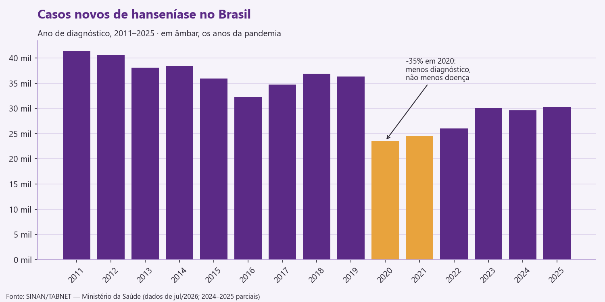
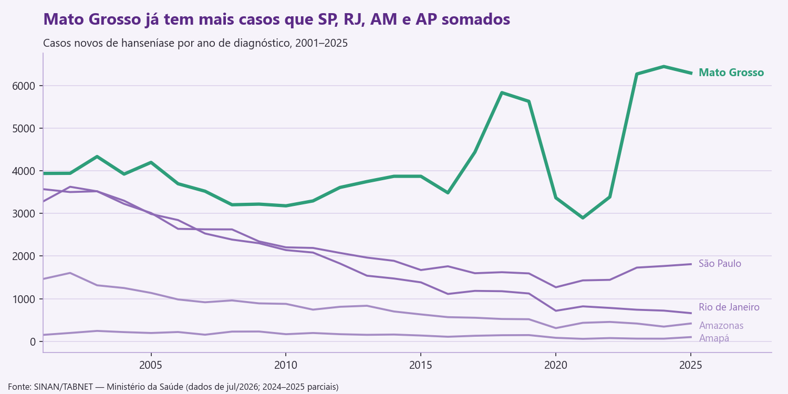
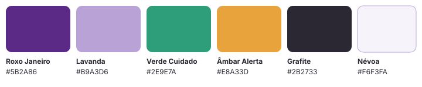

<p align="center">
  
</p>

<h1 align="center">Elo - adesão ao tratamento da hanseníase</h1>

<p align="center">
  <b>FMU Tech Inovação · 1ª Edição · 2026.2</b><br>
  ODS 3 — Saúde e Bem-Estar · Checkpoint 1: Ideação do Projeto
</p>

---

## Sumário

1. [Pitch](#1-pitch)
2. [O problema](#2-o-problema)
3. [Bases de dados](#3-bases-de-dados)
4. [Proposta de solução](#4-proposta-de-solução)
5. [Tecnologias e justificativa](#5-tecnologias-e-justificativa)
6. [Identidade visual](#6-identidade-visual)
7. [Cronograma](#7-cronograma)
8. [Integrantes](#8-integrantes)
9. [Estrutura do repositório](#9-estrutura-do-repositório)

---

## 1. Pitch

A hanseníase tem cura, o remédio é gratuito no SUS e mesmo assim o Brasil registrou cerca de
**500 mil casos novos entre 2011 e 2025** — é o segundo país do mundo em número de casos, atrás
apenas da Índia. O problema não está no remédio, e sim no caminho: são de 6 a 12 meses de
tratamento, com uma dose mensal tomada na unidade de saúde e doses diárias em casa, por pessoas
que muitas vezes escondem o diagnóstico por medo do preconceito. Quem para no meio continua
transmitindo e pode ficar com sequelas permanentes. O **Elo** é um app discreto que acompanha o
paciente dose a dose e avisa a equipe da UBS quando alguém começa a se afastar, antes que a falta
vire abandono. Diferente dos apps genéricos de lembrete de remédio, ele foi desenhado para o
esquema da hanseníase (dose supervisionada + doses diárias, exame dos contatos, sinais de reação)
e liga o paciente ao serviço de saúde, em vez de deixá-lo sozinho com um alarme no celular.

## 2. O problema

### Qual problema queremos resolver

**O abandono e a irregularidade no tratamento da hanseníase.**

A hanseníase é uma doença infecciosa crônica, causada pelo *Mycobacterium leprae*, que atinge pele
e nervos. O tratamento padrão no SUS é a poliquimioterapia única (PQT-U): **6 meses** para os
casos paucibacilares e **12 meses** para os multibacilares, combinando uma dose mensal
supervisionada na Unidade Básica de Saúde (UBS) com doses diárias tomadas em casa.

Um tratamento tão longo tem vários pontos de ruptura:

- **Esquecimento** das doses diárias ao longo de meses, principalmente depois que os sintomas melhoram;
- **Falta à dose mensal supervisionada**, que a equipe muitas vezes só percebe semanas depois;
- **Estigma**: muitos pacientes não contam o diagnóstico nem para a família, e um lembrete com o nome
  da doença na tela do celular já é um risco;
- **Reações hansênicas** (inflamações que podem surgir durante ou depois do tratamento), que o
  paciente confunde com piora e por isso desiste;
- **Contatos não examinados**: quem mora com o paciente precisa ser avaliado, e isso costuma se perder.

Paciente que interrompe o tratamento continua transmitindo a doença e corre risco de incapacidade
física permanente. A proporção de cura e de abandono é um dos indicadores que o Ministério da Saúde
usa para medir a qualidade do controle da hanseníase.

### O que os dados mostram



- Entre 2011 e 2025 foram cerca de **499 mil casos novos** no Brasil, **56,6% em homens**.
- Em 2020 os diagnósticos caíram **35%** em relação a 2019. Isso não significa menos doença: na
  pandemia as unidades atenderam menos e os casos deixaram de ser descobertos. Esses pacientes estão
  chegando agora, muitas vezes já com sequelas.
- Desde 2023 o país voltou ao patamar de **30 mil casos por ano**.



- **Mato Grosso** registrou **6.293 casos em 2025**, mais que o dobro de São Paulo, Rio de Janeiro,
  Amazonas e Amapá **somados** (2.991). A doença se concentra nas regiões Centro-Oeste, Norte e
  Nordeste, onde a distância até a UBS e a internet instável tornam o acompanhamento mais difícil.

### Público e contexto

| Quem | Contexto |
|---|---|
| **Pacientes em tratamento** (público principal) | Adultos, em maioria homens em idade produtiva, com 6 a 12 meses de tratamento pela frente; parte deles com baixa escolaridade e acesso irregular à internet |
| **Equipes da Atenção Básica** (UBS / Estratégia Saúde da Família) | Enfermeiros e agentes comunitários que acompanham vários pacientes e hoje controlam faltas em ficha de papel ou planilha |
| **Familiares e contatos** | Pessoas que moram com o paciente e precisam ser examinadas |
| **Gestão municipal de saúde** | Precisa enxergar onde estão os casos e onde o abandono é maior |

**Recorte do projeto:** o protótipo será pensado para uma UBS de um município hiperendêmico, com
Mato Grosso como cenário de referência, já que é o estado com mais casos entre os analisados.

## 3. Bases de dados

Todas públicas, reais e agregadas — detalhes em [`dados/README.md`](dados/README.md).

| Base | Situação | Uso |
|---|---|---|
| **SINAN — Hanseníase (TABNET/DATASUS)**, casos novos por ano e sexo, Brasil, 2011–2026 | ✅ No repositório | Dimensionar o problema e mostrar a tendência |
| **SINAN — Hanseníase (TABNET/DATASUS)**, casos novos por UF (AM, AP, MT, SP, RJ), 2001–2026 | ✅ No repositório | Escolher o recorte geográfico |
| **Microdados do SINAN — Hanseníase** (DATASUS, via PySUS) | Próxima etapa | Cura e abandono por município — a linha de base que o Elo quer melhorar |
| **Estimativas populacionais do IBGE** | Próxima etapa | Taxa de detecção por 100 mil habitantes |
| **CNES** (Cadastro Nacional de Estabelecimentos de Saúde) | Próxima etapa | Localizar as UBS que tratam hanseníase |

> Dados reais de pacientes são sensíveis (LGPD, art. 11). O protótipo usará **pacientes fictícios**
> e os dados públicos acima, que são agregados e não identificam ninguém.

## 4. Proposta de solução

O Elo tem três partes que conversam entre si:

### 📱 App do paciente
- **Calendário do tratamento** montado a partir do esquema (6 ou 12 meses): mostra a próxima dose
  supervisionada e marca as doses diárias;
- **Lembretes discretos**: a notificação diz "Hora do seu cuidado 💜", nunca o nome da doença; o app
  pode ter ícone e nome neutros na tela inicial;
- **Registro em um toque** da dose tomada, com ícones grandes e opção de áudio, para quem tem
  dificuldade de leitura;
- **"Estou sentindo algo"**: registro rápido de sintomas (dor nos nervos, manchas inflamadas, febre)
  que avisa a equipe e explica que reação não é falha do remédio;
- **Contatos da casa**: lembra o paciente de levar quem mora com ele para ser examinado;
- **Funciona offline** e sincroniza quando houver sinal.

### 🩺 Painel da equipe da UBS
- Lista dos pacientes com semáforo de adesão: 🟢 em dia · 🟡 atrasou dose ou faltou à supervisionada · 🔴 risco de abandono;
- Prioriza a **busca ativa** do agente comunitário: quem visitar primeiro;
- Controle dos contatos examinados e das reações relatadas.

### 📊 Painel epidemiológico público
- Casos, taxa de detecção, cura e abandono por UF e município, a partir dos dados do SINAN e do IBGE;
- Mostra para a gestão onde o abandono é maior e onde o Elo faria mais diferença.

**Como isso ataca o problema:** o abandono raramente acontece de uma vez; começa com uma dose
esquecida, depois uma consulta perdida. O Elo transforma esses sinais pequenos em informação que a
equipe vê na hora, e não semanas depois na ficha de papel.

## 5. Tecnologias e justificativa

| Camada | Tecnologia | Por que escolhemos |
|---|---|---|
| App do paciente | **PWA** com **React + Vite** (`vite-plugin-pwa`) | Instala pelo navegador, sem loja de apps e sem ocupar muita memória em celulares simples. O *service worker* permite usar **offline**, essencial em áreas com sinal fraco. Um único código serve Android e iPhone |
| Notificações | **Web Push API** + Notifications API | Lembretes mesmo com o app fechado, sem depender de SMS pago. (No iPhone exige adicionar o app à tela inicial — será orientado no primeiro acesso) |
| Back-end / API | **Python + FastAPI** | Rápido de desenvolver, gera a documentação da API sozinho (Swagger) e valida os dados com Pydantic. É a mesma linguagem do tratamento de dados e dos painéis, então o grupo trabalha com uma linguagem só fora do app |
| Banco de dados | **PostgreSQL** | Relacional, gratuito e robusto: paciente → tratamento → doses → contatos é um modelo naturalmente relacional. Também guarda as tabelas agregadas do SINAN para o painel |
| ORM / migrações | **SQLAlchemy + Alembic** | Versiona a estrutura do banco junto com o código |
| Tratamento de dados | **pandas** + **PySUS** | pandas para limpar as extrações do TABNET (já usado em `scripts/tratar_dados.py`); PySUS baixa os microdados do SINAN direto do DATASUS |
| Painéis (equipe e epidemiológico) | **Streamlit + Plotly** | Painel interativo escrito só em Python, sem precisar de outro front-end — cabe no prazo do semestre |
| Autenticação | **JWT** (FastAPI) | Separa o acesso do paciente e o da equipe; cada um vê só o que lhe cabe |
| Ambiente e deploy | **Docker Compose**; Render / Streamlit Community Cloud | Todo o grupo roda o mesmo ambiente; hospedagem gratuita para a banca acessar |
| Versionamento | **Git + GitHub** | Histórico do projeto e participação de cada integrante |

**Viabilidade:** o escopo foi fatiado para caber no semestre. No Checkpoint 2 entram o app com
calendário, lembrete e registro de dose, a API com banco e o painel epidemiológico; o painel da
equipe com o semáforo de risco fecha a versão da banca final.

## 6. Identidade visual

Detalhes e justificativas em [`identidade-visual/`](identidade-visual/README.md).



- **Logo:** dois elos entrelaçados — paciente (roxo) e equipe de saúde (verde) — que não podem se
  soltar até o fim do tratamento. Slogan: *cuidado que não se rompe*.
- **Paleta:** Roxo Janeiro `#5B2A86` (referência ao Janeiro Roxo, mês de combate à hanseníase),
  Lavanda `#B9A3D6`, Verde Cuidado `#2E9E7A`, Âmbar Alerta `#E8A33D`, Grafite `#2B2733` e Névoa `#F6F3FA`.
  Sem vermelho: dose atrasada pede lembrete, não alarme.
- **Tipografia:** **Poppins** nos títulos e **Inter** no texto e na interface (Google Fonts).

## 7. Cronograma

| Etapa | Data | Entrega |
|---|---|---|
| ✅ Checkpoint 1 — Ideação | 19/10 a 23/10 | Problema, dados, proposta, identidade visual e pitch (este README) |
| Checkpoint 2 — Protótipo | 09/11 a 13/11 | App do paciente (calendário, lembrete, registro de dose), API + banco, painel epidemiológico com dados do SINAN |
| Apresentação final — Banca | 07 e 08/12 | Painel da equipe com semáforo de adesão, alertas de sintomas, deploy online e demonstração |

## 8. Integrantes

| Nome | Curso | RA | GitHub |
|---|---|---|---|
| Lucas Carmo | Ciência de Dados | 2026106782 | [@lucas144z](https://github.com/lucas144z) |
|Fernando Diógenes Alves Santos | Ciência de Dados | 202610XXXX | [@fdiogenesalvesfdas](https://github.com/fdiogenesalvesfdas)
| _(nome)_ | _(curso)_ | _(RA)_ | _(@usuario)_ |
| _(nome)_ | _(curso)_ | _(RA)_ | _(@usuario)_ |

## 9. Estrutura do repositório

```
elo-hanseniase/
├── README.md                 ← proposta completa (este arquivo)
├── dados/
│   ├── README.md             ← fontes e notas sobre os dados
│   ├── brutos/               ← extrações originais do TABNET
│   └── tratados/             ← CSVs limpos
├── docs/graficos/            ← gráficos usados neste README
├── identidade-visual/        ← logo, paleta e tipografia
├── scripts/tratar_dados.py   ← limpa os dados e gera os gráficos
└── requirements.txt
```

---

<sub>Projeto acadêmico — FMU Tech Inovação 2026.2. Dados: SINAN/TABNET, Ministério da Saúde.</sub>
